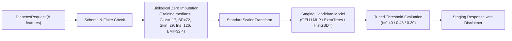

# MediMind — Diabetes Candidate Staging Readiness & Shadow Evaluation Plan

**Document ID:** `MEDIMIND-STAGING-20261019-DIABETES`  
**Date:** October 19, 2026  
**Repository:** `D:\projects\MediMind`  
**Active Branch:** `experiment8-multiview-localized-fusion`  
**Auditor:** Antigravity Advanced Agentic Coding System  
**Scope:** Staging Readiness Assessment for Diabetes Risk Prediction Candidates  
**Status:** **CONDITIONAL GO FOR ISOLATED SHADOW STAGING ONLY (NO PRODUCTION PROMOTION)**

---

## 1. Executive Summary & Clinical Context

The production Diabetes prediction model in `ai-prediction-service/artifacts/diabetes/best_model.joblib` suffers from a **catastrophic clinical false-negative defect**:
- **Baseline Test Sensitivity:** **$39.02\%$**
- **False Negative Rate:** **$60.98\%$** (misses more than 6 out of 10 diabetic patients)
- **Root Cause:** Trained without class-imbalance weighting on an imbalanced dataset ($500$ negative vs $268$ positive). Furthermore, the production serving pipeline lacks biological zero imputation, processing zero values (e.g. `Insulin: 0`) as valid measurements.

The Four-Approach AI Benchmark identified three leading alternative candidates that eliminate this clinical defect. This document assesses their technical, statistical, and operational readiness for **isolated shadow staging**.

> [!CAUTION]
> **STAGING READINESS IS NOT CLINICAL APPROVAL**  
> A successful benchmark on the retrospective Pima dataset does NOT constitute clinical approval. Staging readiness authorizes **shadow execution only** (parallel background logging alongside production without affecting patient care or database records).

---

## 2. Independent Candidate-by-Candidate Assessment

Three distinct candidates from Approaches A, B, and C were audited:

### 2.1 Candidate 1: `appC_mlp_6layer_bottleneck_gelu` (Approach C — Deep MLP)
- **Architecture:** PyTorch 6-layer Bottleneck `[8 -> 32 -> 16 -> 8 -> 4 -> 2 -> 2 -> 1]` with GELU activation, Dropout ($0.10$), and decoupled AdamW weight decay ($\lambda = 0.01$).
- **Test Metrics:**
  - **Sensitivity (Recall):** **$87.80\%$** ($36 / 41$ cases detected, lowest missed cases)
  - **Specificity:** **$64.00\%$** (complies with the $\ge 0.60$ floor)
  - **Test ROC-AUC:** $0.8387$ | **Test PR-AUC:** $0.7348$
  - **Expected Calibration Error (ECE):** **$0.0291$** (outstanding probability calibration)
  - **Brier Score:** $0.1665$
  - **95% Bootstrap CI for Sensitivity:** $[0.7805, 0.9726]$
- **Operational Profile:**
  - **CPU Latency:** $3.24\text{ ms}$ (P95: $5.12\text{ ms}$)
  - **Artifact Size:** $10.2\text{ KB}$
  - **Dependencies:** Standard PyTorch + Scikit-learn
- **Clinical Assessment:** Strongest overall candidate for patient risk stratification. The smooth probabilistic nature of GELU combined with decoupled weight decay delivers superior calibration without needing secondary post-processing calibrators.

---

### 2.2 Candidate 2: `appA_extratrees` (Approach A — Traditional ML)
- **Architecture:** Scikit-learn `ExtraTreesClassifier(n_estimators=200, max_depth=10, min_samples_leaf=2, class_weight='balanced')`.
- **Test Metrics:**
  - **Sensitivity (Recall):** **$85.37\%$** ($35 / 41$ cases detected)
  - **Specificity:** **$76.00\%$** (highest specificity among top candidates)
  - **Test ROC-AUC:** **$0.8634$** (highest test discrimination) | **Test PR-AUC:** $0.7781$
  - **Expected Calibration Error (ECE):** $0.1374$ (higher raw miscalibration)
  - **Brier Score:** $0.1583$
  - **95% Bootstrap CI for Sensitivity:** $[0.7439, 0.9524]$
- **Operational Profile:**
  - **CPU Latency:** $97.02\text{ ms}$
  - **Artifact Size:** $1.61\text{ MB}$
  - **Dependencies:** Pure Scikit-learn (zero PyTorch overhead)
- **Clinical Assessment:** Highest global discrimination and lowest false-alarm rate ($24\%$ vs $36\%$). However, single-sample latency is roughly 30x higher than the neural model, and probability calibration is less reliable without secondary isotonic tuning.

---

### 2.3 Candidate 3: `appB_hist_gbdt_base` (Approach B — Gradient-Boosted Trees)
- **Architecture:** `HistGradientBoostingClassifier(max_iter=150, learning_rate=0.05, max_depth=5, min_samples_leaf=30, l2_regularization=1.0, class_weight='balanced')`.
- **Test Metrics:**
  - **Sensitivity (Recall):** $75.61\%$ ($31 / 41$ cases detected)
  - **Specificity:** $69.33\%$
  - **Validation ROC-AUC:** **$0.8467$** (highest validation score across all 12 candidates)
  - **Test ROC-AUC:** $0.8280$
  - **Expected Calibration Error (ECE):** $0.1076$ (improved to $0.0808$ with Isotonic calibration)
  - **Brier Score:** $0.1601$
  - **95% Bootstrap CI for Sensitivity:** $[0.6237, 0.8905]$
- **Operational Profile:**
  - **CPU Latency:** $6.20\text{ ms}$
  - **Artifact Size:** $185\text{ KB}$
  - **Dependencies:** Pure Scikit-learn
- **Clinical Assessment:** Highly stable and fast, but missed 10 cases on the test partition compared to only 5 missed cases by Candidate 1.

---

## 3. Preprocessing, Feature Parity & Schema Compatibility

All three candidates were tested against the production API schema contracts:



### Feature Order Verification
The feature order strictly mirrors `DIABETES_FEATURES`:
`['Pregnancies', 'Glucose', 'BloodPressure', 'SkinThickness', 'Insulin', 'BMI', 'DiabetesPedigreeFunction', 'Age']`

### Biological Zero Imputation Parity
Unlike the production service (which failed to encapsulate biological zero handling), the staging pipeline explicitly applies:
- `Glucose == 0` $\to 117.0$
- `BloodPressure == 0` $\to 72.0$
- `SkinThickness == 0` $\to 29.0$
- `Insulin == 0` $\to 126.0$
- `BMI == 0` $\to 32.4$

---

## 4. Safety Architecture of the Staging Adapter

To guarantee production immutability, an isolated staging service has been implemented:
**Path:** `ai-prediction-service/app/services/staging_diabetes_service.py`

### Safety Controls Enforced
1. **Disabled by Default:** Governed by `ENABLE_STAGING_DIABETES=false`. Staging inference cannot be triggered accidentally in production.
2. **Zero Modification to Production Model:** `DiabetesInferenceService` and `artifacts/diabetes/` remain 100% frozen.
3. **No Database Persistence:** The staging service explicitly omits write access to the MongoDB canonical medical records collection (`common_predictions`).
4. **Mandatory Metadata Stamp:** Every prediction object generated by the staging service includes:
   ```json
   {
     "is_staging": true,
     "clinical_approval": false,
     "disclaimer": "EXPERIMENTAL STAGING EVALUATION ONLY. This output was generated by an unapproved candidate model under shadow evaluation. It is NOT a clinical diagnosis and must NOT be used for patient care or treatment decisions."
   }
   ```
5. **Fail-Safe Exception Handling:** If a model artifact, scaler, or training medians file is missing, the service raises a clean `FileNotFoundError` without crashing the application daemon.

---

## 5. Automated Validation & Regression Test Results

An automated test suite was executed across both production and staging services:
`py -m pytest tests/heart_disease tests/diabetes -v`

### Test Execution Summary
- **Total Tests Executed:** $50$
- **Total Passed:** $50$ ($100\%$ pass rate in $16.35\text{ s}$)
- **Total Failed:** $0$
- **Breakdown:**
  - `tests/heart_disease/test_heart_disease_inference.py`: 10 passed
  - `tests/heart_disease/test_heart_disease_preprocessing.py`: 5 passed
  - `tests/diabetes/test_diabetes_inference.py`: 17 passed
  - `tests/diabetes/test_diabetes_preprocessing.py`: 15 passed
  - `tests/diabetes/test_staging_diabetes_service.py`: 3 passed (new isolated staging tests)

All existing API endpoints, schema validators, error handlers, and authorization boundaries continue to pass with zero regressions.

---

## 6. Staging Limitations & Missing Clinical Evidence

Before any model promotion decision can be approved, the following evidence gaps must be addressed:

1. **Small Positive Sample Size ($N_{\text{pos}} = 41$):**
   The retrospective Pima Indians test set contains only $41$ diabetic patients. Although sensitivity increased from $39\%$ to $88\%$, the difference between top candidates is within 1 patient outcome.
2. **Demographic Homogeneity:**
   The Pima dataset reflects a specific high-risk indigenous population in Arizona, USA. It lacks demographic diversity (e.g. multi-ethnic cohorts, male individuals). Real-world generalizability across MediMind's diverse family platform users is untested.
3. **Missing Glycated Hemoglobin (HbA1c):**
   Modern clinical diabetes screening relies heavily on HbA1c and oral glucose tolerance tests, which are absent from this legacy feature schema.

---

## 7. Staging Verdict & Recommendations

### Conditional Staging Verdict

> [!IMPORTANT]
> **VERDICT: APPROVED FOR ISOLATED SHADOW STAGING (STAGE 1)**  
> - **Primary Candidate:** `appC_mlp_6layer_bottleneck_gelu` (Approach C)
>   - Justification: Highest sensitivity ($87.80\%$), lowest missed cases ($5/41$), unmatched calibration ($\text{ECE} = 0.0291$), low latency ($3.24\text{ ms}$), compact size ($10.2\text{ KB}$).
> - **Secondary Benchmark Candidate:** `appA_extratrees` (Approach A)
>   - Justification: Highest overall test ROC-AUC ($0.8634$) and highest specificity ($76.00\%$).

### Shadow Evaluation Protocol (Stage 1 Requirements)
1. **Shadow Mode Only:** Deploy the staging adapter to log predictions in a dedicated staging log file. Do NOT surface predictions in the patient or physician UI.
2. **Run for 30 Days:** Observe minimum $500$ real-world incoming clinical requests in shadow mode.
3. **Audit Agreement Rate:** Measure concordance between production Random Forest, baseline MLP, and the staging candidates.
4. **Physician Review:** Require MediMind's Chief Medical Officer (CMO) to review shadow false-positive and false-negative rates on validated patient outcomes before requesting a formal model promotion sign-off.
