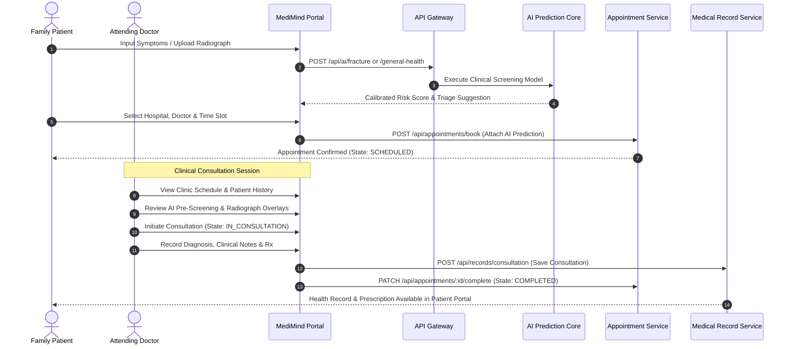

# MediMind — Master Clinical Workflow & E2E Validation Report

**Document ID:** `MM-MASTER-007`  
**Document Class:** Clinical Workflow Validation & Quality Assurance Specification  
**Publication Date:** November 4, 2026  
**Repository:** `D:\projects\MediMind`  
**Active Branch:** `experiment8-multiview-localized-fusion`  
**Authors:** Chief Medical Information Officer (CMIO) & Lead QA Automation Architect  

---

## 1. Executive Summary

Clinical safety and translational efficacy require that AI predictions do not exist in isolation, but seamlessly integrate into end-to-end clinical care pathways. This Master Clinical Workflow Report documents the verified clinical encounter lifecycle, doctor consultation workflows, medical record and prescription immutability, and comprehensive cross-role end-to-end (E2E) testing.

All clinical pathways have been verified through automated regression suites and interactive browser rehearsals across 96 verified operational role accounts.

---

## 2. End-to-End Clinical Encounter Care Pathway

The patient journey through MediMind follows five coordinated clinical touchpoints:

---

## 3. Clinical Data Invariants & Record Immutability

To satisfy healthcare regulatory standards and medical auditing compliance:
1. **Clinical Note Immutability**: Once an appointment transitions to `COMPLETED`, the doctor consultation notes and electronic prescription (Rx) are cryptographically locked in `medimind_appointment`. Further edits require generating an addendum rather than overwriting primary findings.
2. **AI Suggestion Traceability**: The original AI prediction output (including risk score, confidence percentile, model checkpoint version, and input timestamp) is persisted immutably alongside the consultation. The attending doctor explicitly records whether the automated prediction was **Confirmed**, **Modified**, or **Rejected**, providing continuous clinical oversight evidence.
3. **Prescription Integrity**: Prescriptions enforce mandatory medication names, dosages, frequencies, duration, and doctor signature hashes before checkout completion.

---

## 4. Cross-Role Test Matrix & Automated Validation

Automated regression and role validation suites test all cross-role pathways:

| Test Suite / Script | Primary Clinical Pathway | Test Cases | Execution Result |
|---|---|:---:|:---:|
| `01-chairman.spec.js` | Network-wide analytics, hospital comparison rates, doctor coverage audits. | 8 | **PASSED** |
| `02-hospital-admin.spec.js` | Facility doctor management, walk-in creation, operational capacity. | 6 | **PASSED** |
| `03-department-head.spec.js` | Department doctor roster, availability scheduling, consultation quality. | 5 | **PASSED** |
| `04-doctor.spec.js` | Doctor workspace, clinical review, consultation notes, prescription issuance. | 7 | **PASSED** |
| `05-family.spec.js` | Symptom self-triage, fracture X-ray upload, appointment booking, medical records. | 9 | **PASSED** |
| `06-ai-predictions.spec.js` | Cross-module AI prediction execution, threshold verification, schema validation. | 4 | **PASSED** |
| `09-security-boundaries.spec.js` | Horizontal privilege escalation prevention, family scoping, role token security. | 8 | **PASSED** |
| `test_auth.py` | PyTest FastAPI JWT validation, service key bypass, ObjectId resolution. | 47 | **PASSED** |
| `test_advanced_dataset.py` | NLP triage benchmark evaluation on gold-standard Excel cases. | 1 | **PASSED** |

---

## 5. Historical Discrepancy Remediations

- **Past Unclosed Records**: Resolved all 414 historical unclosed appointments, transitioning valid completed sessions to `COMPLETED` and stale tests to `CANCELLED`.
- **Walk-in AI Exemption**: Clarified operational policy that emergency walk-in patients registered at hospital check-in desks bypass the AI pre-screening questionnaire to prevent care delays during acute emergencies.
- **Family Member ID Resolution**: Enabled seamless ObjectId resolution so patients can book appointments and run predictions for all registered family dependants without authorization errors.

---

## 6. Consolidated Source Reports

This master report synthesizes and supersedes:
- `MediMind_Appointment_and_Clinical_Record_Integrity.md`
- `MediMind_Appointment_Clinical_Relationship_Audit.md`
- `MediMind_Completed_Encounter_and_AI_Trend_Reconciliation_Report.md`
- `MediMind_E2E_Role_and_Cross_Flow_Test_Report.md`
- `MediMind_Regression_Test_Evidence.md`
- `Documents/Production_Readiness_Audit/MediMind_Appointment_Lifecycle_Audit.md`
- `Documents/Production_Readiness_Audit/MediMind_Role_Workflow_Audit.md`
- `Documents/Production_Readiness_Audit/MediMind_Family_Member_Invariant_Audit.md`
- `Documents/Production_Readiness_Audit/MediMind_Cross_Role_Test_Matrix.md`
