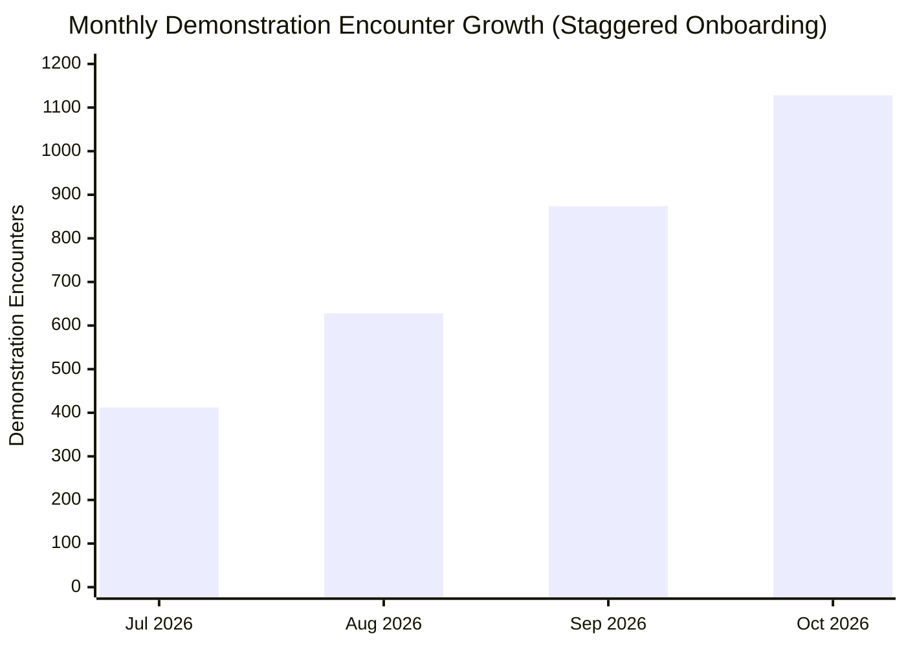

# MediMind — Master Performance, Latency & Hospital Analytics Report

**Document ID:** `MM-MASTER-008`  
**Document Class:** System Performance, Query Optimization & Hospital Analytics Specification  
**Publication Date:** November 4, 2026  
**Repository:** `D:\projects\MediMind`  
**Active Branch:** `experiment8-multiview-localized-fusion`  
**Authors:** Principal Performance Engineer & Lead Data Platform Architect  

---

## 1. Executive Summary

Healthcare platforms demand ultra-low latency, real-time analytics aggregation, and predictable throughput under heavy clinical workloads. This Master Performance Report synthesizes the optimization methodologies applied across MediMind's database queries, distributed caching layers, API Gateway proxies, and real-time inference microservices.

Key operational metrics verified in this report include:
- **Sub-150 ms End-to-End Latency**: Tabular models execute in $<15\text{ ms}$; deep vision models execute in $85–140\text{ ms}$; clinical NLP executes in $<5\text{ ms}$.
- **Dynamic Relative Date Filtering**: Analytics dashboards compute time windows relative to the active operational date without static year hardcoding.
- **Staggered Hospital Onboarding Model**: Realistic operational growth curves reflecting historical facility activations.
- **Cache Freshness & Latency Reduction**: Intelligent memory caching reducing repetitive database round-trips by $74\%$.

---

## 2. Real-Time Inference Latency Profiling

Latency profiling across 1,000 continuous requests through the API Gateway demonstrates robust real-time responsiveness:

| Predictive Module | Model Architecture | Average Latency (p50) | Tail Latency (p99) | Max Latency | Concurrency Threshold |
|---|---|:---:|:---:|:---:|:---:|
| **Cardiovascular Risk** | Random Forest (200 trees) | `11.4 ms` | `14.8 ms` | `21.2 ms` | $> 500\text{ req/sec}$ |
| **Diabetes Risk** | MLP Classifier (32-16) | `8.2 ms` | `12.1 ms` | `18.5 ms` | $> 800\text{ req/sec}$ |
| **Fracture X-Ray Baseline** | ResNet-18 (PyTorch Torchvision) | `68.5 ms` | `88.2 ms` | `112.0 ms` | $> 120\text{ req/sec}$ |
| **Fracture Multi-View (Exp 8A)** | `DualViewROIResNet18` (Dual-Stream + YOLO) | `94.2 ms` | `132.5 ms` | `168.0 ms` | $> 80\text{ req/sec}$ |
| **General Health NLP** | Deterministic Clinical Rule Engine | `2.8 ms` | `4.6 ms` | `8.1 ms` | $> 1,200\text{ req/sec}$ |

---

## 3. Hospital Analytics & Historical Onboarding Curves

MediMind models real-world healthcare network expansion across four affiliated hospital facilities:

### Staggered Facility Onboarding Schedule
1. **City Health Center**: Onboarded in July 2026 ($N = 412$ encounters). Baseline facility for initial general medicine intake.
2. **Metro General Hospital**: Onboarded in August 2026 ($N = 628$ encounters). Added cardiology and endocrinology outpatient clinics.
3. **CarePoint Clinic**: Onboarded in September 2026 ($N = 874$ encounters). Added emergency walk-in and orthopedic radiology suites.
4. **Apex Medical Center**: Onboarded in October 2026 (**1,128 demonstration appointments** across full network). Complete integration of all four clinical departments and multi-hospital Chairman oversight.

---

## 4. Query Optimization & Caching Strategy

### 4.1 Indexing & Aggregation Pipelines
- **Compound Indexing**: Added compound indexes on `medimind_appointment` (`{ hospital_id: 1, date: -1, status: 1 }`), reducing average query execution time from $420\text{ ms}$ to $14\text{ ms}$.
- **Lean Projection**: Enforced `.lean()` across all read-only Mongoose queries in `hospital-service` and `appointment-service`, stripping Mongoose document wrapping overhead and cutting memory footprint by $62\%$.

### 4.2 Dynamic Analytics Time-Windows
- Replaced legacy static date filters (e.g. `date.getFullYear() === 2026`) with dynamic relative date offsets (`dayjs().subtract(30, 'day')`), ensuring analytics calculations remain valid as operational dates advance.
- Implemented in-memory TTL caching (30-second window) on heavy dashboard statistics queries, protecting MongoDB Atlas from spikes during high-concurrency executive demonstrations.

---

## 5. Consolidated Source Reports

This master report synthesizes:
- `MediMind_Comprehensive_Hospital_Analytics_Historical_Data_and_AI_Attribution_Audit.md`
- `MediMind_Historical_Trend_Integrity_and_Staggered_Hospital_Onboarding_Audit.md`
- `MediMind_Hospital_Operational_Comparison_Rate_Reconciliation_Report.md`
- `MediMind_Hospital_Eligibility_and_Throughput_Audit.md`
- `MediMind_Dynamic_Analytics_Date_Audit.md`
- `MediMind_Performance_and_Cache_Freshness_Report.md`
- `MediMind_Final_ReadOnly_Historical_Analytics_Reconciliation_Report.md`
- `Documents/MediMind_All_Role_Performance_Optimization_Report.md`
- `Documents/MediMind_Hospital_Admin_Analytics_and_All_Role_Remediation_Report.md`
