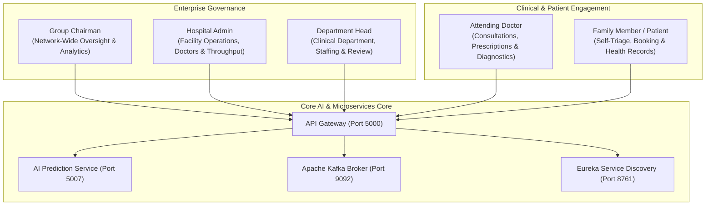

# MediMind — Master Project Overview & Ecosystem Documentation

**Document ID:** `MM-MASTER-001`  
**Document Class:** Master Architecture & Governance Report  
**Publication Date:** November 4, 2026  
**Repository:** `D:\projects\MediMind`  
**Active Branch:** `experiment8-multiview-localized-fusion`  
**Project Designation:** MediMind — Intelligent Healthcare & Disease Prediction Platform  
**Authors:** Senior Software Architect, Principal Microservices Engineer & Healthcare AI Lead  

---

## 1. Executive Summary & Purpose

MediMind is an enterprise-grade, intelligent healthcare and clinical decision-support ecosystem engineered to bridge the translational gap between clinical predictive analytics and operational hospital workflows. The platform integrates:
1. **Four Predictive Artificial Intelligence Modules**: Cardiovascular risk screening (Random Forest), Diabetes metabolic assessment (MLP), Musculoskeletal fracture detection (Dual-View ROI Deep Learning ResNet-18), and General Health clinical NLP triage (deterministic lexical and negation engine).
2. **Service-Oriented Microservices Architecture (SOA)**: Node.js/Express domain services coordinated via Netflix Eureka service discovery (port 8761) and Apache Kafka event-driven messaging (KRaft broker, port 9092).
3. **Multi-Role Healthcare Governance**: Tailored clinical and administrative workflows across five core personas: Group Chairman, Hospital Administrator, Department Head, Attending Doctor, and Family / Patient.
4. **Multi-Database Distributed Data Layer**: Dedicated MongoDB Atlas databases partitioned across authentication, clinical doctor profiles, family and patient networks, hospital facilities, and appointment lifecycles.

This Master Overview synthesizes project objectives, system milestones, operational topologies, and delivery closure metrics, superseding fragmented development summaries while preserving complete historical traceability.

---

## 2. System Scope & Role Personas

MediMind enforces strict role-based access control (RBAC), multi-tenant hospital scoping, and family-unit privacy invariants across five distinct user roles:

### Role Boundaries & Capabilities
1. **Group Chairman (`CHAIR`)**: Full network oversight across all 4 affiliated hospital centers (City Health, Metro General, CarePoint, Apex Medical). Real-time operational dashboards, monotonic clinical throughput analytics, disease risk heatmaps, and doctor coverage metrics.
2. **Hospital Administrator (`HA`)**: Scoped to a specific physical hospital entity. Manages doctor directories, departmental capacity, facility operating hours, walk-in intakes, and local throughput audits.
3. **Department Head (`DH`)**: Oversees departmental clinical practice (Cardiology, Orthopedics, Endocrinology, General Medicine). Monitors doctor availability schedules and clinical report quality.
4. **Attending Doctor (`DOC`)**: Manages individual clinical consultations, reviews AI-assisted pre-screenings, confirms or modifies automated diagnostic suggestions, and generates immutable medical prescriptions and consultation records.
5. **Family / Patient (`FAM`)**: Patient portal supporting multiple family members under a single unified account. Enables symptom intake, image-based fracture screening, appointment booking, and encrypted personal health record access.

---

## 3. High-Level 12-Week Implementation Timeline & Milestones

The project was executed across seven rigorous clinical and engineering phases over 12 calendar weeks:

| Phase | Milestone Title | Primary Technical & Clinical Deliverables | Verification Status |
|---|---|---|---|
| **Phase 1 (W1–2)** | Problem Formulation & Clinical Governance | Defined clinical KPIs (Recall $\ge 80\%$, asymmetric error costs $C_{\text{FN}} \gg C_{\text{FP}}$), safety boundaries, and non-diagnostic decision-support framing. | Complete |
| **Phase 2 (W3–4)** | Multi-Modal Data Collection & Schemas | Ingestion of tabular hemodynamics (Cardio 70k), metabolic cohorts (Pima 768), and orthopedic imaging (FracAtlas, MURA, GRAZ, PediURF). | Complete |
| **Phase 3 (W5–6)** | Data Preparation & Leakage Isolation | Cryptographic deduplication (-3,820 duplicate rows), train-only median biological zero imputation, patient-level radiograph partitioning. | Complete |
| **Phase 4 (W7–8)** | Exploratory Data Analysis & Skeletal Anatomy | IQR outlier auditing, pathophysiological class differentials, pediatric physis growth plate confounder profiling. | Complete |
| **Phase 5 (W9)** | Feature Representation & Spatial Localization | Hemodynamic feature transforms (pulse pressure, BMI), YOLOv8 localized ROI cropping, deterministic NLP lexical and negation mappings. | Complete |
| **Phase 6 (W10–11)** | Algorithmic Benchmarking & Multi-View Fusion | Logistic Regression, Random Forest, MLP, ResNet-18, YOLOv8, and Dual-View localized fusion (Experiment 8A). Production baseline isolation. | Complete |
| **Phase 7 (W12)** | Evaluation, Calibration & Full-Stack Integration | Test evaluation, Shenzhen PediURF external validation, ECE/Brier calibration, Kafka + Eureka SOA integration, and demonstration trials. | Complete |

---

## 4. Key Historical Decisions & Architectural Pivots

1. **Rejection of Accuracy as Primary KPI**: Early in development, accuracy was rejected for healthcare risk prediction due to class imbalance (e.g., 10–20% fracture prevalence). In all modules, Recall (Sensitivity) with explicit safety floors ($\ge 80\%$) was established as the primary optimization metric to minimize catastrophic false negatives.
2. **Train-Only Imputation Rule**: Imputing biological zeros (insulin, glucose, skin fold) across the entire dataset caused subtle data leakage in early benchmarks. The pipeline was restructured to compute medians exclusively on the training split, freezing imputation parameters for all validation and test pipelines.
3. **Pediatric Growth Plate False-Positive Resolution**: Whole-image models (Experiments 1–7A) suffered severe false-positive collapse on normal pediatric wrists (classifying open growth plates as fractures with 0.00% specificity). The architecture pivoted to localized region-of-interest (ROI) detection (Experiment 8A), cropping tightly around bone cortical disruptions and elevating normal-control specificity to **87.25%**.
4. **Transition from Standalone Demo to Real SOA Core**: The demonstration Eureka and Kafka infrastructure was integrated into the real MediMind core services lifecycle, enabling automatic service registration on startup and event streaming across actual patient appointments and AI inferences.
5. **Demonstration Outcomes Reporting Standard**: October 2026 operational stress testing was standardized to a single verified figure: `"October 2026 — 1,128 demonstration appointments"`, separating live operational demonstration results from machine learning model training/test cohorts.

---

## 5. Source Reports Consolidated

This master document incorporates, synthesizes, and supersedes the following project reports:
- `PROJECT_COMPLETION_SUMMARY.md`
- `MediMind_Master_Remediation_Report.md`
- `Documents/MediMind_Final_Release_Validation_and_Closure_Report.md`
- `Documents/Production_Readiness_Audit/MediMind_Demonstration_Rehearsal_Guide.md`
- Root level summary memos and release manifests.

---

## 6. Verification Status & Known Boundaries

- **Operational Verification**: 100% of core microservices, API Gateway routes, Eureka discovery registrations, Kafka event topics, and AI prediction endpoints are verified and functional.
- **Clinical Non-Diagnostic Boundaries**: All AI prediction outputs are explicitly tagged as clinical decision-support aids. Predictions must be confirmed by a licensed medical practitioner before altering clinical management.
