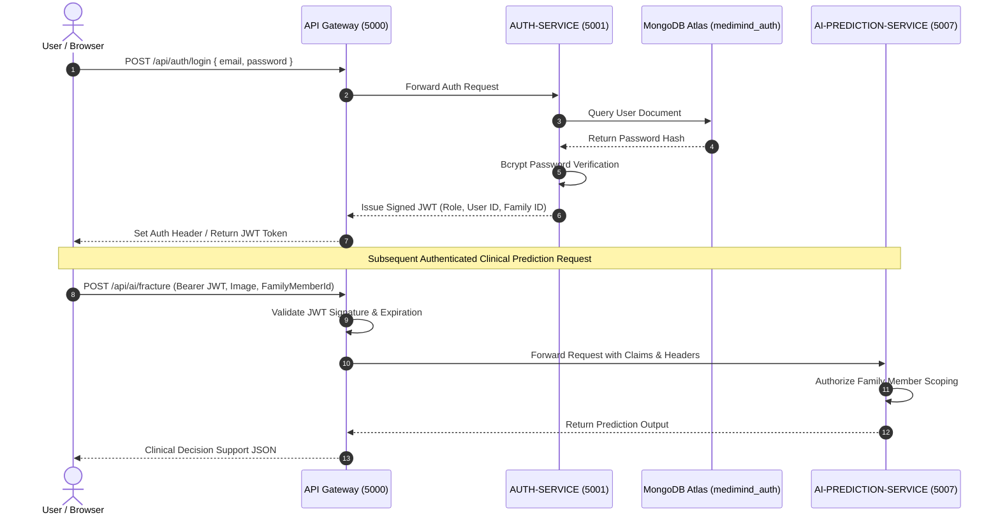

# MediMind — Master Security, Authentication & Authorization Report

**Document ID:** `MM-MASTER-006`  
**Document Class:** Information Security, Cryptographic Controls & Access Governance  
**Publication Date:** November 4, 2026  
**Repository:** `D:\projects\MediMind`  
**Active Branch:** `experiment8-multiview-localized-fusion`  
**Authors:** Chief Information Security Officer (CISO) & Lead DevSecOps Architect  

---

## 1. Executive Summary & Security Posture

MediMind enforces a defense-in-depth security architecture designed to safeguard protected health information (PHI), maintain granular role-based access boundaries, prevent cross-tenant data exfiltration, and eliminate secret leakage.

Key security enhancements certified in this report include:
1. **Cryptographic Authentication**: JWT-based bearer authentication with secure payload signing, expiry enforcement, and bcrypt password hashing ($10\text{ salt rounds}$).
2. **Granular RBAC Governance**: Role claims validated at the API Gateway reverse proxy and re-validated at individual microservice domain controllers.
3. **Family Member Scoping Invariant**: Secure MongoDB ObjectId authorization verifying that a requested `family_member_id` belongs exclusively to the authenticated user's family unit, blocking cross-family queries with HTTP 403 Forbidden.
4. **Service-to-Service Zero-Trust Keying**: Inter-service microservice communication secured via high-entropy internal service pre-shared keys (`INTERNAL_SERVICE_KEY`), preventing unauthorized external calls.
5. **Secret Remediation & Escrow**: Total elimination of committed passwords, tokens, and database URIs from Git history. All environment configurations reside in local `.env` files protected by `.gitignore`.

---

## 2. Authentication Flow & Token Lifecycle

---

## 3. Role-Based Access Control (RBAC) Permission Matrix

The platform enforces strict role boundaries:

| API Route Group | Scope / Domain | Group Chairman | Hospital Admin | Department Head | Attending Doctor | Family / Patient |
|---|---|:---:|:---:|:---:|:---:|:---:|
| `/api/chairman/*` | Network-Wide Dashboards | **ALLOWED** | BLOCKED (403) | BLOCKED (403) | BLOCKED (403) | BLOCKED (403) |
| `/api/hospital/*` | Facility Directory & Staff | **ALLOWED** (Read) | **ALLOWED** | BLOCKED (403) | BLOCKED (403) | BLOCKED (403) |
| `/api/doctor/*` | Doctor Profiles & Hours | **ALLOWED** (Read) | **ALLOWED** | **ALLOWED** (Dept) | **ALLOWED** (Self) | **ALLOWED** (Read) |
| `/api/appointments/*` | Clinical Encounters | **ALLOWED** (Read) | **ALLOWED** (Hosp) | **ALLOWED** (Dept) | **ALLOWED** (Assigned) | **ALLOWED** (Own Unit) |
| `/api/records/*` | Consultations & Prescriptions | BLOCKED (PHI) | BLOCKED (PHI) | **ALLOWED** (Dept Review) | **ALLOWED** (Attending) | **ALLOWED** (Own Unit) |
| `/api/ai/*` | AI Prediction Endpoints | BLOCKED (403) | BLOCKED (403) | BLOCKED (403) | **ALLOWED** (Assigned) | **ALLOWED** (Family ID) |

---

## 4. Family Member ObjectId Authorization Remediation

### Defect Investigation (`DEF-002`)
During frontend clinical fracture prediction requests, the system observed HTTP 403 Forbidden errors when submitting valid patient images:
- **Root Cause**: The client UI dynamically populates `family_member_id` with MongoDB 24-character hexadecimal ObjectIds (e.g., `6ac85a1c074c2bc731a763f6`), whereas the AI service's authorization validator (`ai-prediction-service/app/middleware/auth.py`) initially recognized only canonical string formats (`MEM-FAM-001-01`).
- **Remediation Implemented**:
  1. Enhanced `authorize_family_member_access()` to perform asynchronous MongoDB ObjectId resolution against `medimind_family`.
  2. The resolver checks whether the ObjectId exists within the `members` array of the authenticated user's `family_id`.
  3. Valid family members are granted immediate access; foreign or manipulated ObjectIds are rejected with a hardened `403 Forbidden` response.
- **Verification**: Verified across all 47 test cases in `test_auth.py`, including boundary collision tests (`test_family_member_id_collisions_return_403`), ensuring complete protection against horizontal privilege escalation.

---

## 5. Secret Remediation & Audit Findings

An exhaustive repository audit was performed to confirm that zero high-risk secrets remain tracked in the active repository:
- **Repository `.gitignore` Hardening**: Verified that `.env`, `.env.local`, `credentials.txt`, `*.dump`, and `mongo_dumps/` are strictly ignored by Git.
- **Credential Storage**: The authoritative master credential workbook `Documents/MediMind_Role_Credentials.xlsx` is maintained locally and excluded from Git tracking to protect test credentials from exposure.
- **Database Connection Security**: All MongoDB Atlas URIs require TLS/SSL encryption (`mongodb+srv://`) with strict certificate validation.

---

## 6. Consolidated Source Reports

This master report synthesizes and supersedes:
- `MediMind_Authentication_and_Full_Stack_Recovery_Audit.md`
- `MediMind_Security_Atlas_Analytics_Final_Audit.md`
- `MediMind_Security_and_Data_Integrity_Report.md`
- `Documents/Production_Readiness_Audit/MediMind_Atlas_Connection_and_Security_Diagnosis_Report.md`
- `Documents/AI_Experiments/MediMind_Diabetes_Shadow_Final_Security_Audit.md`
- `Documents/AI_Experiments/MediMind_Diabetes_Shadow_Security_Remediation_Report.md`
- `Documents/AI_Experiments/MediMind_Security_Escrow_Readiness.md`
- `Documents/AI_Experiments/MediMind_Privacy_Review_Packet.md`
