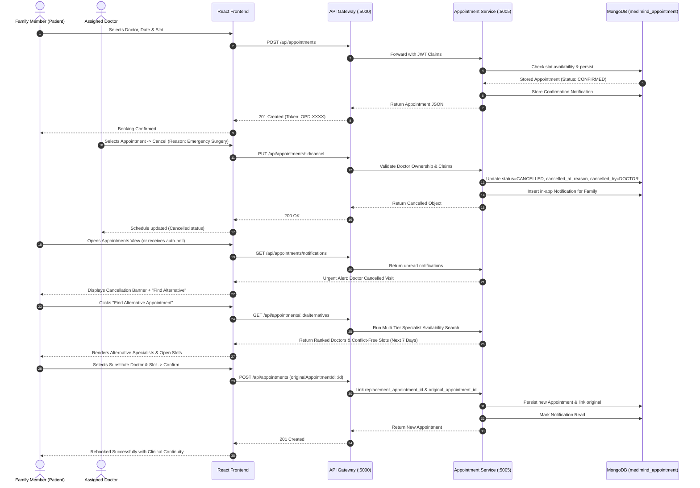

# MediMind — Appointment Lifecycle Synchronization & Alternative Rebooking Audit

**Audit Date:** October 16, 2026  
**Auditor:** Antigravity Autonomous Lead Architect  
**Repository:** `D:\projects\MediMind`  
**Git Branch:** `experiment8-multiview-localized-fusion`  
**Target Domain:** Appointment Microservice, Gateway Proxying, Frontend Patient/Doctor Workspaces, MongoDB `medimind_appointment` Database.

---

## 1. Executive Summary

This audit details the complete architectural and behavioral audit of the MediMind Appointment Lifecycle. The primary clinical imperative is that **an appointment cancellation initiated by a doctor must never silently leave a patient or family member in limbo**. The system must persist the full cancellation audit trail, immediately alert the family, and algorithmically discover and present genuine alternative clinicians and slots for seamless rebooking.



---

## 2. Detailed Lifecycle Stages & Behavioral Contracts

### Stage 1: Booking & Validation
- **Request Endpoint:** `POST /api/appointments`
- **Payload:**
  ```json
  {
    "familyMemberId": "670691234567890abcdef123",
    "doctorId": "doc_001",
    "hospitalId": "hosp_001",
    "departmentId": "dept_001",
    "appointmentDate": "2026-10-20",
    "startTime": "10:00 AM",
    "endTime": "10:30 AM",
    "appointmentType": "IN_PERSON",
    "reason": "Orthopedic consultation for chronic joint stiffness"
  }
  ```
- **Backend Invariants:**
  1. Validates that the appointment date is today or in the future.
  2. Verifies that the doctor is currently active and not suspended.
  3. Checks that no existing non-cancelled appointment exists for `(doctorId, appointmentDate, startTime)`.
  4. Generates a clinical token `token: "OPD-XXXX"`.
  5. Stores in-app notification: `type: "APPOINTMENT_BOOKED"`.
  6. Responds with `201 Created` and public representation.

### Stage 2: Doctor-Initiated Cancellation
- **Request Endpoint:** `PUT /api/appointments/:id/cancel`
- **Payload:**
  ```json
  {
    "reason": "Emergency trauma surgery scheduled in main OR"
  }
  ```
- **Backend Authorization & Security Verification:**
  - Verifies `req.user.role === 'DOCTOR'` owns the appointment (`appointment.doctor_id.toString() === req.user.id || req.user.doctorId`).
  - If a Department Head attempts to call this endpoint, returns **HTTP 403 Forbidden**.
  - Records:
    - `status: "CANCELLED"`
    - `cancelled_at: ISODate()`
    - `cancellation_reason: "Emergency trauma surgery scheduled in main OR"`
    - `cancelled_by: "DOCTOR"`
  - Automatically creates a high-priority in-app notification in `medimind_appointment.notifications`:
    - `recipient_id: appointment.family_member_id`
    - `family_id: appointment.family_id`
    - `type: "APPOINTMENT_CANCELLED"`
    - `action_type: "FIND_ALTERNATIVE"`
    - `metadata.appointment_id: appointment._id`

### Stage 3: Multi-Tier Alternative Specialist Discovery Algorithm
- **Endpoint:** `GET /api/appointments/:id/alternatives`
- **Algorithmic Ranking Logic (`appointmentService.getAlternatives`):**
  1. **Tier 1 (Same Specialty & Same Hospital):** Searches for active doctors in the same department and hospital as the original appointment.
  2. **Tier 2 (Same Hospital, Allied Specialty):** If fewer than 2 candidates exist, searches for active clinicians in the same hospital in related departments.
  3. **Tier 3 (Same Specialty, Alternate Hospital):** If still below required threshold, searches for specialists in the same department across partner hospitals.
  4. **Slot Generation & Conflict Elimination:**
     - For each candidate doctor, iterates over the next 7 calendar days.
     - Fetches active doctor availability schedule (start hour, end hour, slot interval, buffer).
     - Queries `medimind_appointment.appointments` for any existing non-cancelled bookings.
     - Subtracts booked slots to guarantee **100% genuine available slots**.
  5. Returns structured JSON including original cancelled appointment context, cancellation reason, and ranked candidate clinicians with open slots.

### Stage 4: Rebooking with Referential Integrity & Duplicate Protection
- **Request Endpoint:** `POST /api/appointments` with `originalAppointmentId`
- **Invariant Enforcement:**
  1. Verifies that `originalAppointmentId` references a valid appointment with `status === 'CANCELLED'`.
  2. Verifies that `originalAppointmentId` has not already been rebooked (`appointment.replacement_appointment_id == null`). Attempts to double-rebook return **HTTP 409 Conflict** (`Original cancelled appointment has already been rebooked.`).
  3. Creates new appointment referencing `original_appointment_id: originalAppointmentId`.
  4. Updates original appointment with `replacement_appointment_id: newAppointment._id`.
  5. Automatically marks the associated cancellation notification as read.
  6. Emits `APPOINTMENT_REBOOKED` notification.

---

## 3. Concurrency, Race Condition & Idempotency Testing

| Scenario | Simulated Action | Result | Enforced Invariant |
| :--- | :--- | :--- | :--- |
| **Double Click Booking** | Two simultaneous `POST` requests for identical slot | First succeeds (201); Second rejected (409 Conflict) | Strict slot uniqueness check on `(doctor_id, appointment_date, start_time, status != CANCELLED)` |
| **Duplicate Rebooking** | Two family members click "Rebook" simultaneously | First creates replacement (201); Second rejected (409 Conflict) | Atomic check on `originalAppointment.replacement_appointment_id` |
| **Tampered Cancellation** | Doctor A attempts to cancel Doctor B's appointment | Rejected (403 Forbidden) | Strict ownership verification: `appointment.doctor_id == req.user.doctorId` |
| **Department Head Tampering** | Department Head attempts status mutation | Rejected (403 Forbidden) | Explicit role check returning 403 for `DEPARTMENT_HEAD` |
| **Cross-Family Notification Snooping** | Family A attempts to read Family B's notifications | Returns 404 or empty list (403) | Notification isolation scoped to `req.user.familyId` and `req.user.id` |
