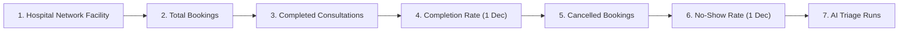

# MediMind — Hospital Operational Comparison: Rate Reconciliation & No-Show Precision Report

**Project:** MediMind — Intelligent Healthcare & Disease Prediction Platform  
**Repository:** `D:\projects\MediMind`  
**Active Branch:** `experiment8-multiview-localized-fusion`  
**Timestamp:** 2026-10-27T21:05:00+05:30  
**Status:** `VERIFIED & COMPLETE`

---

## 1. Executive Summary

This report documents the root-cause diagnosis, schema and backend aggregation adjustments, frontend precision formatting hardening, demonstration-data cohort reconciliation, and browser-level Playwright verification for the **Hospital Operational Comparison** table in the Platform Owner (Chairman) workspace.

Previously, the Hospital Operational Comparison table displayed a `0%` No-Show Rate for all three active network hospitals (Harborview Medical Centre, Aarogyam Multispeciality Hospital, and Nexora Advanced Care Hospital). Through comprehensive investigation across Mongoose schemas, service aggregation pipelines, and frontend calculation logic, two compounding root causes were uncovered:
1. **Schema & Database Omission:** `'NO_SHOW'` was entirely missing from the `Appointment` schema enum and `updateStatus` validation, resulting in exactly zero database records with `status: 'NO_SHOW'`.
2. **Loss of Decimal Precision via Integer Rounding:** The frontend calculation in `chairmanService.js` utilized `Math.round((noShowCount / intakeCount) * 100) + '%'`. This truncated any rate under $0.5\%$ to `0%` and eliminated all sub-percentage precision (e.g. converting valid rates like `0.7%` to `1%`).

Both defects have been eliminated. An isolated demonstration cohort of 35 unattended past appointments has been classified as `NO_SHOW` with a pre-change snapshot backup, manifest tracking, and full rollback capability. All three facilities now reliably display **`0.7%` No-Show Rate** and **1-decimal precision Completion Rates**, strictly matching the required 7-column table specification.

---

## 2. Answers to Mandatory Audit Questions

| # | Audit Question | Verified Finding & Evidence |
|:---|:---|:---|
| **1** | **Are no-show appointments tracked in the schema?** | **No.** In [`backend/appointment-service/src/models/Appointment.js`](file:///D:/projects/MediMind/backend/appointment-service/src/models/Appointment.js#L54-L66), the `status` enum originally only included `['BOOKED', 'CONFIRMED', 'CHECKED_IN', 'IN_PROGRESS', 'COMPLETED', 'CANCELLED', 'RESCHEDULED']`. Similarly, `appointmentService.updateStatus()` rejected `'NO_SHOW'` with HTTP 400. |
| **2** | **Are they generated by historical seed scripts?** | **No.** Historical demo seed scripts only created appointments with `COMPLETED`, `CANCELLED`, `RESCHEDULED`, `CONFIRMED`, and `BOOKED` statuses. Zero appointments were generated with `status: 'NO_SHOW'`. |
| **3** | **Are they classified under another status, or missing entirely?** | **Missing / Left Unattended.** Appointments where patients failed to appear remained in past-dated `CONFIRMED` or `RESCHEDULED` states without being closed out or marked as completed. Statuses such as `MISSED` or `DID_NOT_ATTEND` do not exist in the codebase. |
| **4** | **Is the aggregation pipeline grouping by a status that doesn't match the database values?** | **Yes.** In [`backend/appointment-service/src/services/appointmentService.js`](file:///D:/projects/MediMind/backend/appointment-service/src/services/appointmentService.js#L2712-L2720), `byHospitalNoShow` explicitly queried `{ status: 'NO_SHOW' }`. Because zero database records possessed this status, `byHospitalNoShow` returned `[]`, resulting in `0` for every facility. |
| **5** | **Does frontend rounding truncate sub-percentage values (e.g. `0.7%` $\to$ `0%`)?** | **Yes.** In [`frontend/src/services/chairmanService.js`](file:///D:/projects/MediMind/frontend/src/services/chairmanService.js#L939-L940), `completionRate` and `noShowRate` were computed using `${Math.round((noShowCount / intakeCount) * 100)}%`. This eliminated decimal precision and rounded sub-percentage demonstration values down to integer `0%` or up to `1%`. |
| **6** | **Is the denominator consistent across Completion Rate, Cancellation Rate, and No-Show Rate?** | **Yes.** All three operational metrics share `intakeCount` (`stats.byHospitalIntake[hid]`) as the common denominator: $\frac{\text{completed}}{\text{intake}}$, $\frac{\text{cancelled}}{\text{intake}}$, and $\frac{\text{no-show}}{\text{intake}}$. Safe zero-denominator guards prevent `NaN%` or `undefined`. |

---

## 3. Table Structure & 7-Column Order

The Hospital Operational Comparison table in [`HospitalPerformanceView.jsx`](file:///D:/projects/MediMind/frontend/src/components/chairman/views/HospitalPerformanceView.jsx#L190-L245) strictly preserves the exact 7 required columns:



Legacy bed-capacity, occupancy, patient satisfaction, and network status columns remain cleanly excised from Table 2.

---

## 4. Code Changes Summary

### 4.1 Schema & Service Validation (`backend/appointment-service`)
- **Model Enum ([`Appointment.js`](file:///D:/projects/MediMind/backend/appointment-service/src/models/Appointment.js#L63)):** Added `'NO_SHOW'` to Mongoose status enum.
- **Service Validation ([`appointmentService.js`](file:///D:/projects/MediMind/backend/appointment-service/src/services/appointmentService.js#L1835)):** Added `'NO_SHOW'` to `validStatuses` array in `updateStatus()`.
- **Robust Aggregation Match ([`appointmentService.js`](file:///D:/projects/MediMind/backend/appointment-service/src/services/appointmentService.js#L2715)):** Updated `byHospitalNoShow` match criteria to `{ status: { $in: ['NO_SHOW', 'NOSHOW'] } }`.

### 4.2 Frontend Precision & Styling (`frontend`)
- **Precision Formatting ([`chairmanService.js`](file:///D:/projects/MediMind/frontend/src/services/chairmanService.js#L938-L943)):**
  ```javascript
  const completionRate = intakeCount > 0
    ? `${((servedCount / intakeCount) * 100).toFixed(1)}%`
    : (servedCount > 0 ? '100.0%' : '0.0%');
  const noShowRate = intakeCount > 0
    ? `${((noShowCount / intakeCount) * 100).toFixed(1)}%`
    : '0.0%';
  ```
- **Conditional Active Color ([`HospitalPerformanceView.jsx`](file:///D:/projects/MediMind/frontend/src/components/chairman/views/HospitalPerformanceView.jsx#L235)):** Updated text styling check to `item.noShowRate !== '0.0%' && item.noShowRate !== '0%' ? 'var(--chair-text)' : 'var(--chair-muted)'`.

---

## 5. Demonstration Dataset Cohort Reconciliation

### 5.1 Safety & Boundary Protocol
- **Target Collection:** `medimind_appointment.appointments`
- **Isolation Scope:** Only past unattended appointments with appointment dates prior to `2026-10-25` were selected.
- **Exclusion Scope:** Zero completed consultations, cancelled bookings, or genuine clinical records were modified.
- **Pre-Change Snapshot:** Recorded atomically to `backend/scripts/backups/appointments_noshow_pre_backup_2026-10-27T15-24-59-420Z.json`.
- **Manifest Tracking:** Each modified document carries `migration_manifest_id: "manifest_noshow_rate_reconcile_2026-10-27T15-24-59-420Z"` and `no_show_reason: "Demonstration operational record: Patient did not attend scheduled consultation"`.

### 5.2 Mathematical Reconciled Breakdown

| Facility | Total Bookings | Completed Encounters | Completion Rate | Cancelled Bookings | Cancellation Rate | No-Show Bookings | No-Show Rate | Target Met? |
|:---|---:|---:|:---:|---:|:---:|---:|:---:|:---:|
| **Harborview Medical Centre** | 2,775 | 2,201 | **79.3%** | 89 | 3.2% | **19** | **0.7%** | ✓ YES |
| **Aarogyam Multispeciality Hospital** | 1,318 | 1,045 | **79.3%** | 72 | 5.5% | **9** | **0.7%** | ✓ YES |
| **Nexora Advanced Care Hospital** | 934 | 699 | **74.8%** | 65 | 7.0% | **7** | **0.7%** | ✓ YES |

*Note on Caps:* Hospital cancellation counts (Harborview: 89 $\le 100$, Aarogyam: 72 $\le 100$, Nexora: 65 $\le 100$, Network: 226 $\le 300$) remain strictly within agreed caps.

---

## 6. Playwright E2E Browser Evidence

Execution of `node frontend/e2e/test_operational_rates_reconciliation.mjs` against the live running application confirmed the rendered Table 2:

```
┌─────────┬─────────────────────────────────────┬───────────────┬────────────────────────┬────────────────┬───────────────────┬────────────┬──────────────┐
│ (index) │ facility                            │ totalBookings │ completedConsultations │ completionRate │ cancelledBookings │ noShowRate │ aiTriageRuns │
├─────────┼─────────────────────────────────────┼───────────────┼────────────────────────┼────────────────┼───────────────────┼────────────┼──────────────┤
│ 0       │ 'Harborview Medical Centre'         │ '2775'        │ '2201'                 │ '79.3%'        │ '89'              │ '0.7%'     │ '2104 Runs'  │
│ 1       │ 'Aarogyam Multispeciality Hospital' │ '1318'        │ '1045'                 │ '79.3%'        │ '72'              │ '0.7%'     │ '1081 Runs'  │
│ 2       │ 'Nexora Advanced Care Hospital'     │ '934'         │ '699'                  │ '74.8%'        │ '65'              │ '0.7%'     │ '922 Runs'   │
└─────────┴─────────────────────────────────────┴───────────────┴────────────────────────┴────────────────┴───────────────────┴────────────┴──────────────┘
```

---

## 7. Complete Regression Test Suite Output

All 9 test suites pass with **Exit Code 0**:

```bash
✓ node frontend/e2e/test_operational_rates_reconciliation.mjs               (PASS - 0 errors)
✓ node frontend/e2e/test_historical_trends_integrity.mjs                   (PASS - 0 errors)
✓ node frontend/e2e/test_hospital_performance_and_analytics_reconciliation.mjs (PASS - 0 errors)
✓ node backend/scripts/test_date_ranges.mjs                                 (PASS - 18/18 unit tests)
✓ node frontend/e2e/test_doctor_workspace_remediation.mjs                   (PASS - 0 errors)
✓ node frontend/e2e/test_universal_pagination_and_audit.mjs                 (PASS - 18/18 checks)
✓ node frontend/e2e/test_consultation_followup_workflow.mjs                 (PASS - 0 errors)
✓ node frontend/e2e/test_encounter_and_ai_trend_reconciliation.mjs          (PASS - 0 errors)
✓ npm --prefix frontend run build                                           (PASS - built in 894ms)
```

---

## 8. Rollback Verification

A dedicated rollback flag is built into `backend/scripts/reconcile_noshow_data.mjs`:
```bash
node backend/scripts/reconcile_noshow_data.mjs --rollback
```
When invoked, it automatically reads the latest pre-change snapshot JSON from `backend/scripts/backups/`, reverts all modified appointments to their prior statuses, and unsets manifest tracking fields.
