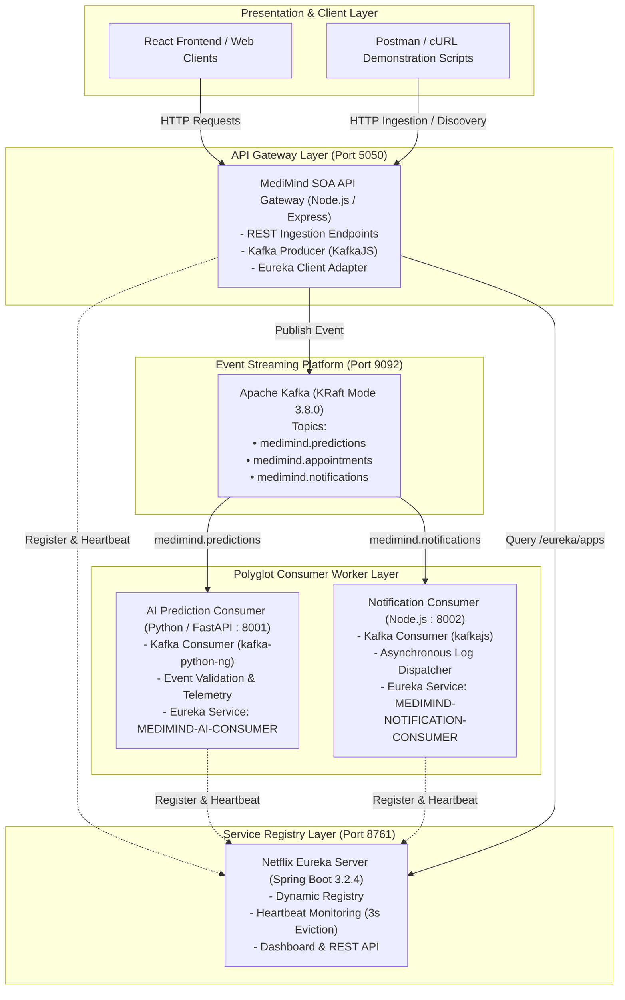

# MediMind Service-Oriented Architecture (SOA) Demonstration

> **Event-Driven Microservices with Apache Kafka & Netflix Eureka Service Discovery**  
> *MediMind Intelligent Healthcare & Disease Prediction Platform*

---

## 1. Architecture Overview

This module provides a dedicated, non-invasive Service-Oriented Architecture (SOA) demonstration for the **MediMind** healthcare ecosystem. It showcases enterprise-grade event-driven choreography via **Apache Kafka** and dynamic service discovery via **Netflix Eureka Server** without disrupting existing clinical prediction pipelines, authentication boundaries, or database schemas.

### Core Architectural Principles
1. **Decoupled Asynchronous Messaging**: Event producers publish domain notifications and prediction requests to Kafka topics without blocking client responses.
2. **Dynamic Service Registration & Discovery**: Polyglot microservices (Node.js & Python) register dynamically with Netflix Eureka, emitting periodic heartbeats and enabling dynamic client discovery.
3. **Clinical Safety & Isolation**: Demonstration events are strictly demarcated (`isDemo: true`) to demonstrate queueing and worker telemetry without generating simulated diagnosis or violating patient confidentiality.
4. **Zero Impact on Existing Base**: All SOA components reside strictly in `soa-demo/`, reusing existing runtime dependencies via clean adapters.

---

## 2. Mermaid Architecture Diagram



---

## 3. Technology Stack

| Component | Technology | Version | Purpose |
| :--- | :--- | :--- | :--- |
| **Event Streaming** | Apache Kafka | 3.8.0 (KRaft) | High-throughput distributed event streaming and message broker |
| **Service Registry** | Netflix Eureka / Spring Boot | Spring Boot 3.2.4 / Eureka 4.1 | Dynamic microservice discovery, health registry, and dashboard |
| **API Gateway & Producer** | Node.js / Express.js / KafkaJS | Node 22+ / KafkaJS 2.2.4 | Isolated gateway exposing demo APIs, Kafka producer, and discovery proxy |
| **Prediction Consumer** | Python / FastAPI / kafka-python-ng | Python 3.14 / FastAPI 0.110+ | Asynchronous event worker subscribing to `medimind.predictions` |
| **Notification Consumer**| Node.js / KafkaJS / Express | Node 22+ / KafkaJS 2.2.4 | Asynchronous event worker subscribing to `medimind.notifications` |
| **Containerization** | Docker & Docker Compose | Docker v29+, Compose v5.5+ | Local infrastructure orchestration |

---

## 4. Kafka Producer and Consumer Architecture

### Kafka Topics
- **`medimind.predictions`** (3 partitions, replication 1): Receives clinical prediction request events for cardiovascular, diabetes, general triage, and musculoskeletal assessments.
- **`medimind.appointments`** (3 partitions, replication 1): Receives appointment scheduling, rescheduling, and cancellation events.
- **`medimind.notifications`** (3 partitions, replication 1): Receives patient communication triggers (SMS, Email, Push).

### Standard Event Envelope
All published Kafka events adhere to an immutable JSON envelope:
```json
{
  "eventId": "c7650ea9-f815-4fa2-b2d4-118e7456d92a",
  "eventType": "PredictionRequested",
  "patientId": "DEMO-001",
  "predictionType": "HEART_DISEASE",
  "timestamp": "2026-10-30T04:14:56.328Z",
  "source": "medimind-api",
  "metadata": {
    "environment": "soa-demonstration",
    "isDemo": true
  }
}
```

### AI Prediction Consumer (`MEDIMIND-AI-CONSUMER`)
- Subscribes to `medimind.predictions` using consumer group `medimind-ai-prediction-group`.
- Enforces strict schema validation (checks presence of `eventId`, `eventType`, `patientId`, `predictionType`, `timestamp`, `source`).
- Implements idempotent event tracking via memory deduplication cache.
- Logs structured telemetry demonstrating asynchronous handover without executing unverified medical diagnoses.

### Notification Consumer (`MEDIMIND-NOTIFICATION-CONSUMER`)
- Subscribes to `medimind.notifications` using consumer group `medimind-notification-group`.
- Processes simulated notifications across supported channels (`EMAIL`, `SMS`, `PUSH`).
- Exposes worker metrics and last processed event state via `/health`.

---

## 5. Eureka Registration and Service Discovery

All microservices register via the Eureka REST API at startup:
- **`MEDIMIND-API`** on port `5050`
- **`MEDIMIND-AI-CONSUMER`** on port `8001`
- **`MEDIMIND-NOTIFICATION-CONSUMER`** on port `8002`

### Lifecycle Management
1. **Registration**: Services send `POST /eureka/apps/{APP_NAME}` with `InstanceInfo` detailing `instanceId`, `hostName`, `ipAddr`, `port`, `healthCheckUrl`, and `statusPageUrl`.
2. **Periodic Heartbeat**: Every 10 seconds, background timers emit `PUT /eureka/apps/{APP_NAME}/{INSTANCE_ID}?status=UP&lastDirtyTimestamp={ts}`.
3. **Graceful Deregistration**: On shutdown (`SIGINT`/`SIGTERM`), services emit `DELETE /eureka/apps/{APP_NAME}/{INSTANCE_ID}` to purge themselves immediately from the registry.
4. **Dynamic Discovery**: Client callers query `GET /api/soa/services` to obtain real-time instance endpoints directly from Eureka.

---

## 6. Installation & Prerequisites

Ensure the following runtimes are installed:
- **Docker Desktop** (WSL2 engine active)
- **Node.js** (v18+)
- **Python** (3.10+) with `pip`

Install dependencies:
```powershell
# 1. API Gateway dependencies
npm --prefix soa-demo/api-gateway install

# 2. Notification Consumer dependencies
npm --prefix soa-demo/notification-consumer install

# 3. Python AI Consumer dependencies
pip install kafka-python-ng requests uvicorn fastapi pydantic
```

---

## 7. Environment Variables

Create `.env` inside `soa-demo/` or use system defaults:

```ini
# Kafka
KAFKA_BROKERS=localhost:9092
KAFKA_CLIENT_ID=medimind-api-gateway

# Eureka Server
EUREKA_SERVER_URL=http://127.0.0.1:8761
EUREKA_HOST=127.0.0.1
EUREKA_PORT=8761

# Services Ports
SOA_GATEWAY_PORT=5050
PREDICTION_CONSUMER_PORT=8001
NOTIFICATION_CONSUMER_PORT=8002
```

---

## 8. Starting & Stopping the Demonstration

### Start Infrastructure (Kafka & Eureka)
```powershell
powershell -ExecutionPolicy Bypass -File soa-demo/scripts/start-infra.ps1
```

### Start Demonstration Services
```powershell
powershell -ExecutionPolicy Bypass -File soa-demo/scripts/start-demo.ps1
```

### Stop Demonstration & Infrastructure
```powershell
powershell -ExecutionPolicy Bypass -File soa-demo/scripts/stop-demo.ps1
```

---

## 9. API Testing with cURL

### 1. Health Checks
```bash
# API Gateway Health
curl http://localhost:5050/health

# AI Prediction Consumer Health
curl http://localhost:8001/health

# Notification Consumer Health
curl http://localhost:8002/health
```

### 2. Comprehensive Status Check
```bash
curl http://localhost:5050/api/soa/status
```

### 3. Dynamic Eureka Service Discovery
```bash
curl http://localhost:5050/api/soa/services
```

### 4. Publish Prediction Event to Kafka
```bash
curl -X POST http://localhost:5050/api/soa/predictions \
  -H "Content-Type: application/json" \
  -d '{
    "patientId": "PAT-CARDIO-8821",
    "predictionType": "HEART_DISEASE"
  }'
```

### 5. Publish Notification Event to Kafka
```bash
curl -X POST http://localhost:5050/api/soa/notifications \
  -H "Content-Type: application/json" \
  -d '{
    "recipientId": "PAT-CARDIO-8821",
    "channel": "SMS",
    "message": "MediMind Reminder: Fasting blood glucose appointment tomorrow at 9:00 AM."
  }'
```

---

## 10. Automated Integration Verification

Execute the end-to-end automated integration suite:
```powershell
node soa-demo/tests/soa_integration_test.mjs
```

### Test Suite Validations:
1. Eureka Server availability on port 8761.
2. Kafka broker availability on port 9092.
3. API Gateway registration with Eureka (`MEDIMIND-API`).
4. AI Consumer registration with Eureka (`MEDIMIND-AI-CONSUMER`).
5. Notification Consumer registration with Eureka (`MEDIMIND-NOTIFICATION-CONSUMER`).
6. Kafka publication to `medimind.predictions`.
7. Python AI Consumer message ingestion & validation.
8. Kafka publication to `medimind.notifications`.
9. Node.js Notification Consumer message ingestion & logging.
10. Dynamic discovery of all 3 registered services.
11. Overall health and status telemetry.

---

## 11. Known Limitations & Demonstration Scoping
- **Clinical Inference Isolation**: Demonstration events do not invoke live machine learning model weights or record medical assessments into production patient charts, preserving clinical safety.
- **In-Memory Deduplication**: Event ID deduplication cache operates in-memory for demonstration efficiency rather than distributed Redis clustering.
- **Single Node Broker**: Kafka operates in single-node KRaft mode suited for local demonstration rather than multi-zone broker partitioning.
